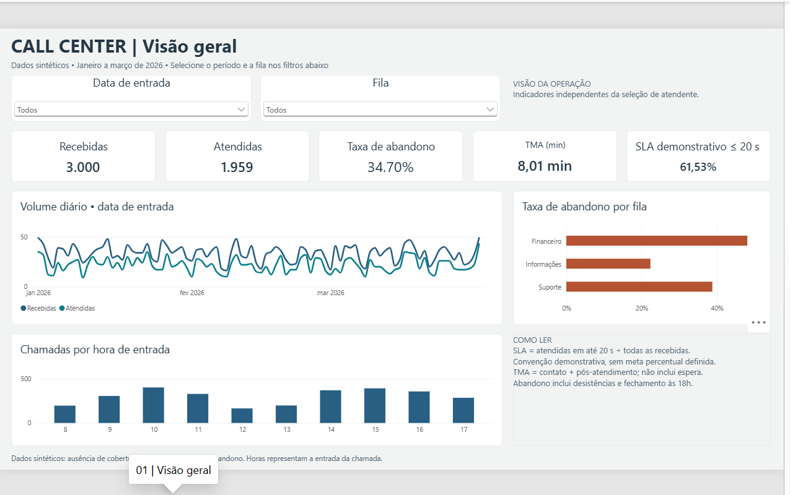

<!-- cca-v1.8-rc1 -->
# Call Center Analytics — demonstração Power BI

**3.000 chamadas 100% sintéticas · oito atendentes · três filas**

[Conheça o projeto e veja as duas páginas](portfolio/call-center-analytics-v1.8-rc1/README.md) ·
[Baixe a candidata v1.8 RC1](portfolio/call-center-analytics-v1.8-rc1/artifacts/CallCenterAnalytics_v1_8_RC1.zip) ·
[Evidências e ressalvas do QA](portfolio/call-center-analytics-v1.8-rc1/docs/PARECER_QA_RECEBIDO.md)

Aprovado com ressalvas para demonstração no GitHub. A candidata final não tem homologação
completa de M/DAX no Desktop; simulador original ausente da entrega; validação Python
obrigatória para sobreposição de ocupações. Nenhum dado representa operação ou cliente real.

Prévia histórica: os filtros de data da candidata usam intervalo. Detalhes na apresentação.
O conteúdo anterior deste README foi preservado abaixo.

---

# call-center-analytics
Projeto demonstrativo de BI para call center, com dados 100% sintéticos, Power BI, Python e testes de consistência.
