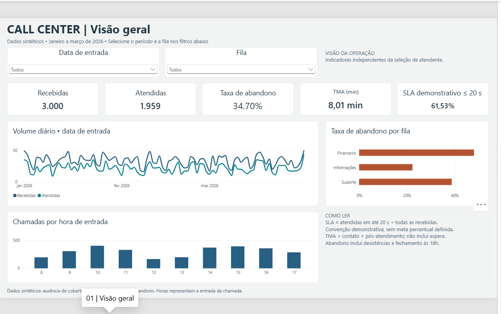
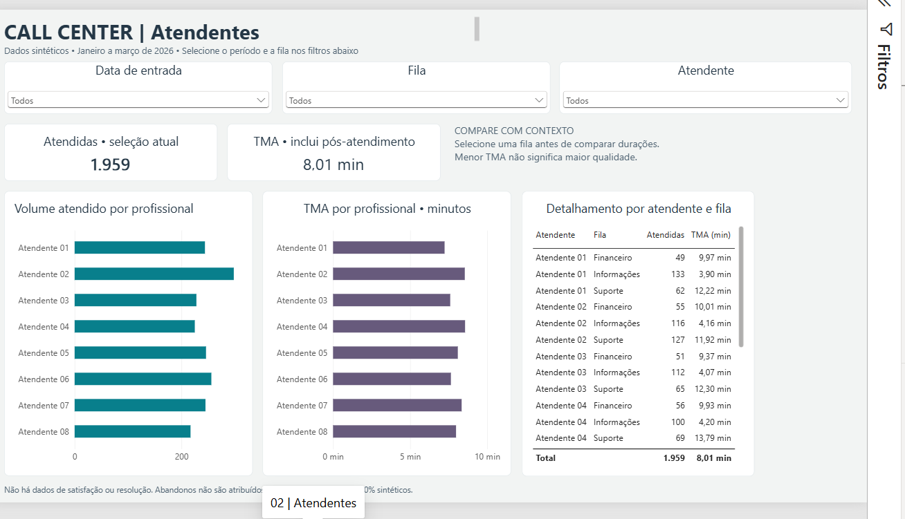

# Call Center Analytics

**Power BI · Power Query · DAX · Python · SQL/SQLite**

Repositório de destino: [AmomDeAbreu/call-center-analytics](https://github.com/AmomDeAbreu/call-center-analytics).

Como acompanhar demanda, abandono e tempo de atendimento em uma central de chamadas?
Este projeto demonstrativo organiza **3.000 chamadas sintéticas**, de janeiro a março de 2026,
em duas páginas: **Visão geral** e **Atendentes**. São oito profissionais e três filas.

> **Dados 100% sintéticos.** Nenhum registro representa cliente, empregador ou operação real.
> **QA: aprovado com ressalvas para disponibilização demonstrativa no GitHub**, conforme parecer
> recebido do responsável. A candidata final tem validação parcial; [consulte os limites](#validacao-e-limites).

[Tutorial: instalar, baixar, abrir e testar](#tutorial-do-zero) ·
[Release v1.8 RC1](https://github.com/AmomDeAbreu/call-center-analytics/releases/tag/v1.8-rc1) ·
[Baixar candidata v1.8 RC1](https://github.com/AmomDeAbreu/call-center-analytics/releases/download/v1.8-rc1/CallCenterAnalytics_v1_8_RC1.zip) ·
[Entrega com evidências](artifacts/Entrega_CallCenterAnalytics_v1_8_RC1.zip) ·
[Código e modelo](demonstracao/CallCenterAnalytics_v1_8_RC1) ·
[Checksums](artifacts/SHA256SUMS.txt)

O download contém um projeto para Power BI Desktop; não é um dashboard interativo no navegador.

## Prévia do relatório

Capturas reais enviadas pelo responsável durante o desenvolvimento, reproduzidas sem edição.
Elas antecedem a candidata final: mostram filtros de data em lista, enquanto a v1.8 RC1 usa intervalo.
São prévias da apresentação, não evidência de renderização da candidata final.

### Visão geral


### Atendentes


## Perguntas respondidas

- Como o volume de chamadas varia por dia e hora de entrada?
- Qual é o volume atendido e abandonado em cada fila?
- Quantas chamadas são atendidas em até 20 segundos?
- Como volume e duração de atendimento variam entre profissionais, considerando a fila?

## Indicadores da base demonstrativa

| Indicador | Valor | Definição |
|---|---:|---|
| Recebidas | 3.000 | Todas as chamadas no contexto de data/fila |
| Atendidas | 1.959 | Chamadas com atendimento |
| Abandonadas | 1.041 | Chamadas sem atendimento, incluindo fechamento |
| Taxa de abandono | 34,70% | Abandonadas ÷ recebidas |
| TMA | 8,01 min | Tempo de contato + pós-atendimento ÷ atendidas; sem espera |
| SLA demonstrativo ≤ 20 s | 61,53% | 1.846 atendidas em até 20 s ÷ 3.000 recebidas |

O TMA consolidado é ponderado por chamadas. Abandonadas não são atribuídas a profissionais.
Os KPIs operacionais ignoram o filtro de atendente e preservam data/fila por definição das medidas;
a execução desse comportamento na candidata final não foi homologada.
O SLA não possui meta percentual aprovada; menor TMA não significa automaticamente melhor qualidade.
Esses valores descrevem uma simulação e não representam ganhos de uma operação real.

## Competências demonstradas

- Modelagem dimensional, relações e medidas DAX para indicadores operacionais.
- Tratamento e validações de carga em Power Query.
- Organização visual de informações em duas páginas de análise.
- Conferência dos dados com Python e consultas SQL/SQLite.
- Documentação de critérios, testes, limitações e integridade por SHA-256.

O projeto usa arquivos CSV e formatos PBIP, PBIR e TMDL. Power Automate e bancos MySQL
fazem parte da experiência declarada do responsável, mas não são dependências desta demonstração.

## Estrutura

| Caminho | Conteúdo |
|---|---|
| `artifacts/` | ZIPs auditados imutáveis e checksums |
| `demonstracao/CallCenterAnalytics_v1_8_RC1/` | Extração idêntica da candidata, para inspeção do código |
| `…/projeto/` | PBIP, relatório PBIR e modelo TMDL |
| `…/*.csv` | Quatro CSVs da base original |
| `…/validacao/` | Validador Python, testes e regressão SQL/estrutura |
| `…/casos_desktop/` | Dez fontes controladas de teste; não usar como base demonstrativa |
| `…/conferencias/` | Manifesto e registros da preparação auditada |
| `assets/` | Capturas autênticas e proveniência |
| `docs/` | Parecer recebido, notas da versão e evidências anteriores |
| `scripts/` | Verificação da publicação, separada da candidata |

<a id="tutorial-do-zero"></a>
## Comece aqui: do download ao primeiro teste

**Escolha seu caminho:**

| Quero… | Caminho |
|---|---|
| Conhecer o painel sem instalar nada | Veja as [duas capturas reais](#prévia-do-relatório) e os indicadores acima |
| Usar os filtros e explorar o relatório | Siga as etapas 1 a 6 abaixo em um computador Windows |
| Conferir dados e código no Mac, Linux ou Codespaces | Veja a [validação sem Desktop](#testar-sem-desktop); a interface do Power BI exige Windows |

As seções abaixo podem ser abertas e recolhidas. Os comandos são para copiar, mas não executam dentro deste README. As imagens são prévias estáticas; esta entrega não contém um painel interativo hospedado na web.

<a id="instalar"></a>
<details open>
<summary><strong>1 · Instale o Power BI Desktop e o Python</strong></summary>

**Power BI Desktop — para abrir o painel**

1. Use um computador Windows que atenda aos [requisitos oficiais da Microsoft](https://learn.microsoft.com/en-us/power-bi/fundamentals/desktop-get-the-desktop#minimum-requirements).
2. Acesse a [página oficial de instalação](https://learn.microsoft.com/en-us/power-bi/fundamentals/desktop-get-the-desktop). Escolha a Microsoft Store ou o instalador de 64 bits. O Power BI Desktop é gratuito.
3. Conclua a instalação e abra o aplicativo uma vez. Use a versão atual do **Power BI Desktop**, com suporte a projetos PBIP; a edição para Power BI Report Server é diferente.

O Codespaces executa os validadores Python, mas não fornece a interface do Desktop. Em Mac/Linux, você pode estudar o código e testar os dados; para abrir este relatório, use um ambiente Windows compatível.

**Python — para validar os dados antes de atualizar**

1. Instale uma versão estável do Python 3.10 ou superior pelo [site oficial](https://www.python.org/downloads/windows/). Siga as [instruções para Windows](https://docs.python.org/3/using/windows.html).
2. Abra uma nova janela do PowerShell e execute:

```powershell
python --version
```

Deve aparecer `Python 3.x.x`, com versão igual ou superior a 3.10. Se sua instalação disponibilizar apenas `py`, use `py` no lugar de `python` nos comandos deste guia.

Não é necessário instalar pacotes com `pip`, SQL Server, MySQL, Excel ou Power Automate. Os validadores usam a biblioteca padrão do Python. O Python é executado no terminal; não configure scripts Python dentro do Power BI.

</details>

<a id="baixar"></a>
<details>
<summary><strong>2 · Baixe o arquivo correto e extraia tudo</strong></summary>

1. Abra a [release v1.8 RC1](https://github.com/AmomDeAbreu/call-center-analytics/releases/tag/v1.8-rc1).
2. Em **Assets**, baixe [CallCenterAnalytics_v1_8_RC1.zip](https://github.com/AmomDeAbreu/call-center-analytics/releases/download/v1.8-rc1/CallCenterAnalytics_v1_8_RC1.zip). Esse é o projeto para experimentar. `Entrega_…zip` reúne evidências adicionais; `Source code (zip)` é o código do repositório e tem outra estrutura.
3. No Explorador de Arquivos do Windows, clique com o botão direito no ZIP e escolha **Extrair Tudo**. Preserve o ZIP original; trabalhe na pasta extraída.
4. Entre na pasta que contém, juntos, estes quatro arquivos: `chamadas.csv`, `atendentes.csv`, `filas.csv` e `disponibilidade_atendentes.csv`. Ela também deve conter `projeto`, `validacao` e `conferencias`.

Essa pasta é a **raiz da candidata**. Dependendo do local escolhido para extração, pode haver duas pastas com o mesmo nome uma dentro da outra. Identifique a raiz pelos quatro CSVs, não apenas pelo nome.

**Conferência opcional do download:** abra o PowerShell na pasta que contém o ZIP e execute:

```powershell
& {
$ErrorActionPreference = 'Stop'
$esperado = '741f6cbf143c5682d1fd5555d50185d51555aaccc6221c8899b05a39e332db5e'
$obtido = (Get-FileHash '.\CallCenterAnalytics_v1_8_RC1.zip' -Algorithm SHA256).Hash
if ($obtido.ToLowerInvariant() -ne $esperado) { throw 'Hash diferente: interrompa e confira o download.' }
Write-Host 'SHA-256 do ZIP: OK'
}
```

Não abra o PBIP diretamente de dentro do ZIP nem mova somente o arquivo `.pbip`: ele referencia as pastas do relatório e do modelo.

</details>

<a id="validar-antes-de-abrir"></a>
<details>
<summary><strong>3 · Valide a extração antes da primeira abertura</strong></summary>

No Explorador, abra a **raiz da candidata**, clique na barra de endereço, digite `powershell` e pressione Enter. Cole:

```powershell
& {
$ErrorActionPreference = 'Stop'
python -X utf8 -B validacao/conferir_manifesto.py
if ($LASTEXITCODE -ne 0) { throw 'Manifesto divergente. Não prossiga.' }

python -X utf8 -B validacao/validar.py .
if ($LASTEXITCODE -ne 0) { throw 'Dados inválidos. Não prossiga.' }

Write-Host 'Extração e dados conferidos. Próxima etapa: abrir o PBIP.'
}
```

**Esperado:** manifesto `PASS`, 125 arquivos conferidos e nenhuma divergência; validador `PASS`, incluindo 3.000 recebidas e 1.959 atendidas.

`-B` evita criar cache Python; `-X utf8` padroniza a leitura de textos com acentos. O ponto final no comando do validador significa “usar os CSVs desta pasta”.

Antes de **cada atualização normal** no Desktop, execute novamente `python -X utf8 -B validacao/validar.py .` e prossiga apenas com `PASS`, mantendo os mesmos CSVs. Isso é necessário porque a rejeição de sobreposição de ocupações depende desse validador externo.

O manifesto deve ser conferido na extração intacta. Configurar a fonte e salvar no Desktop altera a cópia de trabalho e pode gerar cache; não recalcule o manifesto auditado para esconder essas alterações. Para nova conferência de distribuição, extraia o ZIP novamente em outra pasta.

</details>

<a id="abrir-e-configurar"></a>
<details>
<summary><strong>4 · Abra o projeto, configure a origem e carregue os dados</strong></summary>

1. Na raiz extraída, entre em `projeto` e abra **`CallCenterAnalytics.pbip`** com o Power BI Desktop. Se o Windows não reconhecer a extensão, use **Abrir com** e selecione o Desktop. [Como abrir um PBIP](https://learn.microsoft.com/pt-br/power-bi/developer/projects/projects-overview).
2. No Desktop, selecione **Página Inicial → Transformar dados**. No Editor do Power Query, abra **Página Inicial → Gerenciar parâmetros**.
3. Selecione **`PastaDados`** e troque o **Valor Atual** pelo caminho completo da pasta que contém os quatro CSVs da etapa 2. Copie o caminho da barra de endereço do Explorador e cole **sem aspas**.
4. Confirme com **OK**, escolha **Fechar e Aplicar** e aguarde a carga. Depois use **Página Inicial → Atualizar** com os CSVs já validados.

Exemplo de caminho — substitua pelo local real da sua extração:

```text
C:\Projetos\CallCenterAnalytics_v1_8_RC1
```

O valor distribuído, `C:\CallCenterAnalytics\dados`, é apenas um exemplo neutro. Não aponte para `projeto`, para um arquivo CSV isolado nem para `casos_desktop` no uso normal. [Referência de parâmetros](https://learn.microsoft.com/en-us/power-query/power-query-query-parameters).

Como o pacote não inclui cache de dados, os visuais podem ficar sem valores antes da carga. Um erro de “arquivo/pasta não encontrado” nessa etapa deve ser tratado corrigindo `PastaDados`; não é necessário editar DAX nem importar os CSVs como novas tabelas.

**Esperado após uma atualização bem-sucedida:** a página Visão geral exibe os cinco KPIs e gráficos. Se ainda houver erro de atualização, não considere valores antigos ou visuais vazios como confirmação de sucesso.

</details>

<a id="testar-o-painel"></a>
<details>
<summary><strong>5 · Explore os filtros e compare os resultados</strong></summary>

Na Visão geral, comece com **01/01/2026 a 31/03/2026**, todas as filas e nenhuma seleção em gráficos. Para selecionar fevereiro, preencha os dois campos do filtro de intervalo: **01/02/2026** e **28/02/2026**. Não é necessário clicar em cada dia nem usar Shift.

| Experimento | Como selecionar | Resultado esperado |
|---|---|---|
| Base completa | Visão geral; período inteiro; todas as filas | 3.000 recebidas; 1.959 atendidas; abandono 34,70%; TMA 8,01 min; SLA 61,53% |
| Fevereiro | Visão geral; 01/02 a 28/02/2026; todas as filas | 889 recebidas; 574 atendidas; TMA 7,48 min |
| Suporte | Visão geral; período inteiro; fila Suporte (F02) | 1.070 recebidas; 655 atendidas; TMA 12,48 min |
| Filtros combinados | Visão geral; fevereiro; fila Suporte | 300 recebidas; 152 atendidas; TMA 12,02 min |
| Um profissional | Atendentes; período inteiro; todas as filas; Atendente 01 (AT01) | 244 atendimentos atribuídos; TMA por atendente 7,24 min |
| Só abandonadas | Visão geral; início e fim em 04/01/2026; fila Suporte | 8 recebidas; 0 atendidas; abandono 100%; SLA 0%; TMA em branco |

Esses são **controles calculados dos CSVs**, não uma declaração de que as interações da candidata final já foram homologadas no Desktop.

Os filtros das duas páginas são independentes. Ao mudar de página, confira período, fila e atendente novamente. Para limpar, use a borracha do filtro, quando disponível, ou retorne a todas as opções; restaure o período completo. Clique novamente em uma barra selecionada para desfazer a seleção e confira se os totais voltam.

Na página Atendentes, observe os oito profissionais na mesma ordem nos dois gráficos. O TMA consolidado é tempo total dividido por atendimentos, não a média simples das barras.

**Atenção à interpretação:** indicadores operacionais ignoram atendente; medidas “por atendente” respondem ao profissional escolhido. Abandonadas não são atribuídas a profissionais. Para o cenário só abandonadas, use o recorte de data/fila indicado; um filtro direto de `status` não equivale a esse teste.

</details>

<a id="salvar-e-retomar"></a>
<details>
<summary><strong>6 · Salve sua cópia e confira a reabertura</strong></summary>

1. Limpe as seleções de teste nas duas páginas e volte à Visão geral.
2. Salve a cópia de trabalho, feche o Desktop e reabra o mesmo `.pbip`.
3. Valide novamente os CSVs no terminal antes de clicar em **Atualizar**.
4. Confira os totais globais da etapa 5 e se as duas páginas permanecem legíveis.

Checklist para sua própria exploração:

- [ ] A atualização terminou sem erro.
- [ ] Os totais globais correspondem aos controles.
- [ ] O intervalo de fevereiro e a fila Suporte funcionaram.
- [ ] Atendente 01 mostra 244 atendimentos no período completo.
- [ ] A limpeza de filtros retorna aos totais.
- [ ] Salvar, reabrir e atualizar preserva o funcionamento.

Essa exploração não substitui o aceite completo do QA. Se encontrar uma divergência, registre versão do Desktop, página, filtros, esperado, observado e a mensagem de erro. Você pode relatar em [Issues](https://github.com/AmomDeAbreu/call-center-analytics/issues), sem anexar credenciais ou dados pessoais.

</details>

<a id="testar-sem-desktop"></a>
<details>
<summary><strong>Para análise técnica · Testes sem Power BI Desktop</strong></summary>

Use uma extração intacta e execute os comandos na raiz da candidata. No Windows, pode usar PowerShell; no Mac/Linux/Codespaces, use o terminal. Se necessário, troque `python` por `python3` ou `py`.

Execute um comando por vez e prossiga apenas com código de saída zero:

```bash
python -X utf8 -B validacao/conferir_manifesto.py
python -X utf8 -B validacao/validar.py .
python -X utf8 -B validacao/testar.py
python -X utf8 -B validacao/regressao_qa.py
python -X utf8 -B validacao/conferir_manifesto.py
```

| Verificação | Esperado na candidata intacta | O que comprova |
|---|---|---|
| Manifesto, antes/depois | `PASS`; 125 arquivos; nenhuma divergência | Correspondência dos arquivos com o manifesto |
| Validador | `PASS`; saída zero | Regras de consistência dos quatro CSVs |
| Suíte externa | 13 casos com `PASS`; saída zero | Casos positivos e rejeições em Python |
| Regressão SQL/estrutura | `PASSOU`; 50 verificações aprovadas; saída zero | Controles numéricos e estrutura dos arquivos |

O SQL usa SQLite em memória. Nenhum servidor de banco é necessário. Os 13 casos não são a suíte original do simulador; esses comandos não executam M, DAX nem a interface do Desktop.

No checkout completo do repositório, a alternativa que valida os ZIPs e executa os testes em pasta temporária é:

No PowerShell do Windows:

```powershell
$env:PYTHONUTF8 = '1'
python -X utf8 -B portfolio/call-center-analytics-v1.8-rc1/scripts/check_candidate.py
```

No Mac/Linux/Codespaces:

```bash
PYTHONUTF8=1 python -X utf8 -B portfolio/call-center-analytics-v1.8-rc1/scripts/check_candidate.py
```

Execute essa alternativa na **raiz do repositório**, não na raiz do ZIP candidato. Esse script não está dentro do ZIP auditado.

</details>

<details>
<summary><strong>Para QA · Contexto vazio e fontes inválidas</strong></summary>

Os testes negativos são opcionais para conhecer o painel. Use uma segunda extração descartável; não substitua os CSVs originais.

Para observar um contexto vazio, execute na raiz dessa cópia:

```bash
python -X utf8 -B validacao/validar.py casos_desktop/09_sem_chamadas
```

Depois de `PASS`, abra o projeto dessa cópia e aponte `PastaDados` para o caminho completo de `casos_desktop/09_sem_chamadas`. Atualize sem filtros: contagens devem ser zero; abandono percentual, TMA e SLA devem ficar em branco, sem erro de atualização. Trata-se de um resultado esperado, ainda sujeito à verificação no Desktop.

Os demais cenários e a camada responsável por cada rejeição estão no [roteiro de aceite](demonstracao/CallCenterAnalytics_v1_8_RC1/ROTEIRO_DESKTOP.txt). No ZIP, esse arquivo fica na raiz. O caso `06_ocupacao` deve ser rejeitado pelo Python e não deve prosseguir à atualização normal; não se exige bloqueio M equivalente.

Testes específicos de rejeição M são feitos somente na cópia descartável e registrados separadamente da validação Python. Ao terminar, feche essa cópia e volte ao projeto com os quatro CSVs originais.

</details>

<details>
<summary><strong>Precisa de ajuda? Problemas comuns e próximos passos</strong></summary>

| Sintoma | O que conferir |
|---|---|
| `python` não é reconhecido | Reabra o terminal após instalar; teste `py --version` e consulte as instruções oficiais do Python |
| `can't open file …validacao…` | O terminal deve estar na pasta com os quatro CSVs e a pasta `validacao` |
| O manifesto falha depois de salvar no Desktop | Confira uma nova extração; a cópia de trabalho já foi modificada. Não atualize o manifesto auditado |
| Windows não abre `.pbip` ou acusa formato incompatível | Confira a versão atual do Desktop e abra com esse aplicativo; não renomeie para `.pbix` |
| Não encontra `chamadas.csv` | Corrija `PastaDados` para a pasta dos quatro CSVs, sem aspas |
| Painel sem valores na primeira abertura | Configure a origem, valide os CSVs e conclua a atualização; o pacote não inclui cache |
| Valores diferentes da tabela | Confira período, fila, profissional, seleções nos gráficos e a página ativa |
| Datas aparecem como lista | Confirme que abriu a candidata v1.8 RC1; as capturas históricas mostram uma versão anterior |
| Mac, Linux ou Codespaces não abrem a interface | Use as capturas e a validação Python; o Desktop precisa de Windows compatível |

Se o problema persistir, registre o erro em vez de alterar os dados ou as medidas para forçar os valores esperados. Nenhuma etapa deste guia exige publicar no Power BI Service ou usar “Publicar na Web”.

</details>


<a id="validacao-e-limites"></a>
## Validação e limites

Os registros da preparação anterior e o parecer independente recebido do QA relatam:

| Verificação | Resultado registrado |
|---|---|
| Manifesto da candidata | 125 arquivos; nenhuma divergência |
| Validador dos CSVs | PASS |
| Suíte externa | 13/13 |
| Regressão SQL/estrutura | 50/50 |
| Dez conjuntos controlados em Python | 10/10 com comportamento esperado |
| Recálculo independente | Indicadores globais e recortes conferem |

Fontes: [registro de execução anterior](docs/verificacao_anterior.json),
[relatório de preparação auditado](demonstracao/CallCenterAnalytics_v1_8_RC1/RELATORIO_QA.md)
e [resumo do parecer recebido](docs/PARECER_QA_RECEBIDO.md).
O relatório interno antecede o aceite do QA e permanece intacto por rastreabilidade.

**Ressalvas:**

1. Gerador, configuração e suíte original do simulador ausentes desta entrega.
   Não há comprovação de regeneração integral ou FIFO pelo gerador original.
2. M/DAX e interação da candidata final não foram executados no Desktop na preparação auditada.
   Python, SQL e inspeção textual não substituem essa execução.
3. Sobreposição de ocupações é rejeitada pelo validador Python obrigatório.
   O Desktop não executa esse validador automaticamente nem oferece bloqueio M equivalente declarado.

Escopo do aceite: projeto demonstrativo no GitHub. Não é homologação para Power BI Service
ou Publicar na Web, nem garantia de operação em produção.

Para conferir a cópia publicada, siga a seção [Testes sem Power BI Desktop](#testar-sem-desktop).
Ela diferencia os comandos do ZIP candidato e do checkout completo.

O arquivo `.github/workflows/verify-call-center.yml` desta pasta é um **modelo de workflow**.
Como está dentro de `portfolio/call-center-analytics-v1.8-rc1/`, não está instalado em
`.github/workflows/` na raiz do repositório e não ativa CI automaticamente.

## Identidade da candidata

`CallCenterAnalytics_v1_8_RC1.zip`

```text
741f6cbf143c5682d1fd5555d50185d51555aaccc6221c8899b05a39e332db5e
```

A documentação de apresentação é separada da candidata. Nenhum ZIP auditado foi recomprimido.

## Sobre o responsável

**Amom Abreu**, estudante de Engenharia de Sistemas, com experiência em Power BI,
SQL/MySQL, Power Automate e indicadores operacionais. Este projeto de portfólio demonstra
aplicações de BI e validação de dados; não representa uma entrega contratada por cliente.
Contato direto não informado nesta preparação.

## Licenciamento

Nenhuma licença de uso foi encontrada no pacote auditado. A licença do repositório de destino
ainda precisa ser verificada; esta apresentação não atribui permissões adicionais.
